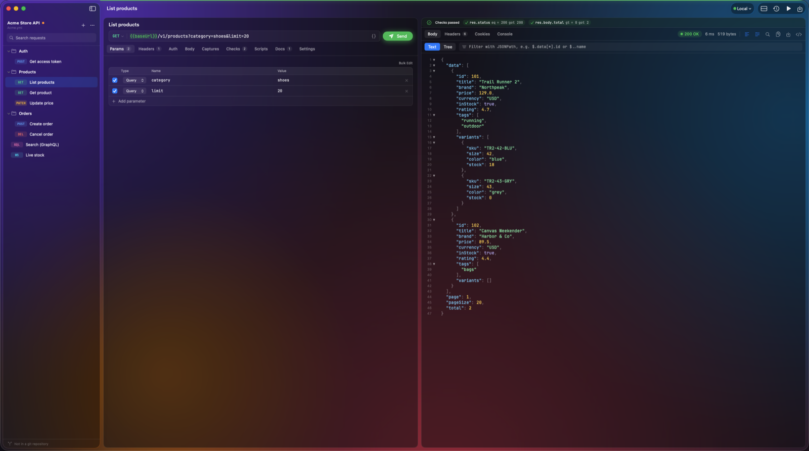
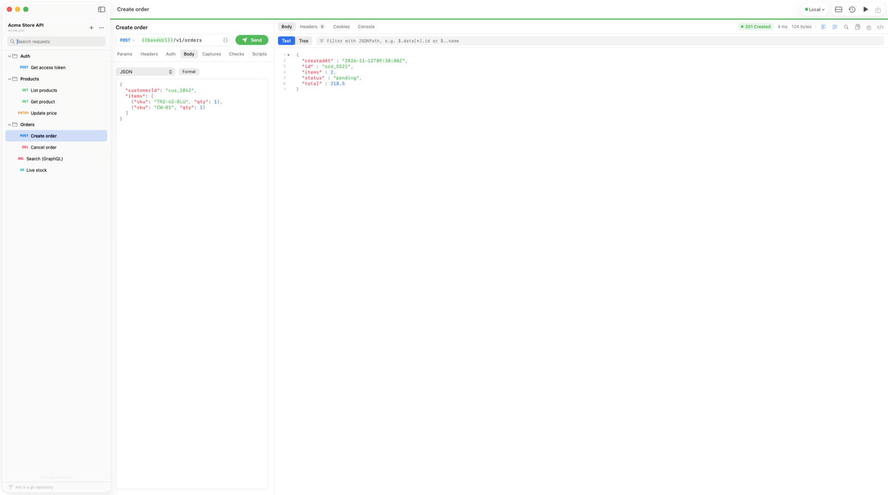
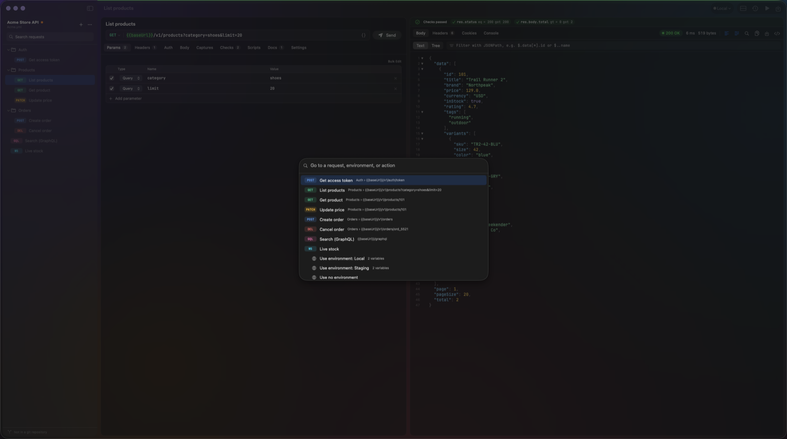
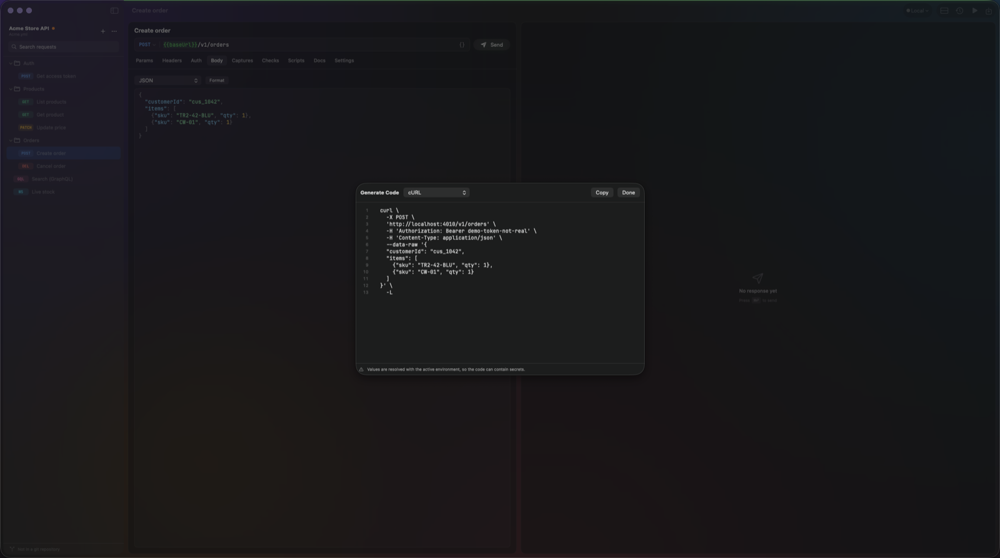

# Gowa

A fast, native HTTP client for macOS, with collections stored as
[OpenCollection](https://www.opencollection.com/) YAML files you can keep in git.



<table>
  <tr>
    <td></td>
    <td></td>
    <td></td>
  </tr>
  <tr>
    <td align="center">Side-by-side layout</td>
    <td align="center">Command palette (⌘K)</td>
    <td align="center">Generate code</td>
  </tr>
</table>

## Install

**One line** — downloads the latest release into `/Applications`:

```sh
curl -fsSL https://raw.githubusercontent.com/nyelonong/gowa/main/scripts/install.sh | sh
```

**Manual**: grab `Gowa.app.zip` from the [latest release](https://github.com/nyelonong/gowa/releases/latest), unzip, and drag `Gowa.app` to `/Applications`.

> The app is ad-hoc signed (no Apple notarization). macOS may show an
> "unidentified developer" warning on first launch — right-click → Open
> once, or let the install script clear the quarantine flag.

**Build from source**:

```sh
swift build -c release && scripts/make-app.sh
```

## Features

**Requests**
- **HTTP, GraphQL, WebSocket, and gRPC** — gRPC learns methods by server
  reflection or from a descriptor set / `.proto` file (compiled with `protoc`
  or `buf` when installed) and supports unary and all streaming kinds.
- **Server-Sent Events** — `text/event-stream` responses show events as they
  arrive; Stop keeps what was received.
- **Bodies** — JSON, text, XML, form URL-encoded, multipart (text and file
  parts), binary file, and GraphQL query + variables.
- **Auth** — Basic, Bearer, API Key, and OAuth 2.0 (client credentials,
  password, authorization code with PKCE, implicit) with token fetch, refresh,
  and Keychain caching. Other spec auth types are preserved in the YAML.
- **Scripts** — pre-request, post-response, and test scripts in JavaScript with
  a Bruno-compatible `req` / `res` / `bru` / `test` / `expect` API. Scripts run
  in JavaScriptCore with no file or network access and stop after 5 seconds.
- **Captures and checks** — pull values from responses into variables and
  assert on status, time, headers, and JSON paths.

**Variables and environments**
- `{{name}}` placeholders everywhere, colored green (defined), red (unknown),
  or purple (built-in function), with the value on hover and completion after `{{`.
- Built-in functions: `{{$uuid}}`, `{{$timestamp}}`, `{{$isoTimestamp}}`,
  `{{$randomInt(1,10)}}`, `{{$base64(text)}}`, `{{$sha256(text)}}`,
  `{{$hmacSha256(key, text)}}`, and more.
- Collection and folder defaults: headers, auth, variables, scripts, and docs
  that every request inside inherits.
- Environment colors tint the Send button and a stripe above the editor.
- **Secrets stay out of git** — mark a variable Secret and its value lives in
  the macOS Keychain; the collection file holds the name only.

**Responses**
- Line numbers, word wrap, JSON folding, a collapsible tree, JSONPath and XPath
  filters, image / PDF / HTML previews (HTML without JavaScript or network),
  timing breakdown, cookies, console output, and diff with the previous response.
- **History** of every send with its response; reopen the request or add it
  back to the collection. Credential headers are never saved.
- **Code generation** for cURL, HTTPie, JavaScript, Python, Go, and Swift.

**Network**
- Per-collection cookie jar, proxy (system, off, or custom with auth and
  bypass list), client certificates (PKCS#12; PEM for gRPC), and an opt-in
  switch to skip TLS verification for test servers.

**Workflow**
- `⌘K` command palette, sidebar search (`⌘⇧F`), drag and drop to reorder,
  paste a cURL command into the URL bar, bulk edit params and headers as text,
  response beside or below the request (`⌥⌘L`), and the collection's git branch
  and changes in the sidebar.

**Look**
- A frosted-glass window with the request and response on separate panels, in
  light and dark mode. Turn it off with View › Glass Window.
- Code in [JetBrains Mono](https://www.jetbrains.com/lp/mono/) with ligatures
  (`=>`, `!==`); turn them off with View › Code Ligatures. The font is bundled
  under the SIL Open Font License (`Resources/Fonts/OFL.txt`).

## Build

Requires Xcode with the Swift 6 toolchain and macOS 15+.

```sh
swift build              # debug
swift build -c release   # release
scripts/make-app.sh      # Gowa.app bundle (ad-hoc signed)
scripts/make-app.sh --open
```

## CLI

The same binary doubles as a headless collection runner for CI:

```sh
# from a release build
.build/release/gowa run ~/path/to/collection.yml --env Production

# or via the app bundle
Gowa.app/Contents/MacOS/gowa run collection.yml

# only requests whose name contains "Users"
gowa run collection.yml --filter Users

# list folders and requests with their IDs, then run one request or folder
gowa list collection.yml
gowa run collection.yml --id 0.2

# one JSON report with each response's status, headers, body, and check results
gowa run collection.yml --id 0.2 --json
gowa list collection.yml --json
```

Runs every HTTP and GraphQL request top-to-bottom with `{{variables}}`,
scripts, captures (chained tokens flow between requests), and checks. Exit codes: `0` all passed,
`1` failures, `2` usage error — CI-friendly.

JSON reports show request URLs as written (`{{base}}/users`) and leave out
request headers, so Gowa does not print variable or secret values itself.
Responses and script output (`console.log`, test messages) are reported as
received, including any tokens in them. Bodies over 1 MB are
cut, and non-text bodies are base64.

## Tests

```sh
swift test
```

## The git workflow

1. Pick a folder that is (or will be) a git repository.
2. `⌘S` saves the collection as `YourName.yml` there.
3. Review and commit with git as usual — diffs are plain YAML, keys sorted
   deterministically.
4. The sidebar footer shows the branch and whether the collection file changed.

## Where Gowa keeps data outside the collection

| What | Where |
| --- | --- |
| Secret variable values, OAuth tokens | macOS Keychain (service `id.afrani.app.gowa`) |
| Cookies with an expiry date | `~/Library/Application Support/Gowa/cookies/` (owner-only) |
| Request history | `~/Library/Application Support/Gowa/history.json` (owner-only, credential headers removed) |

## Structure

| File | Role |
| --- | --- |
| `Sources/gowa/GowaApp.swift` | App entry, menus, CLI dispatch |
| `Sources/gowa/AppState.swift` | Observable state: selection, send, runner, history, WebSocket and gRPC sessions |
| `Sources/gowa/OpenCollection.swift` | OpenCollection YAML model — dictionary-first for lossless round-trips |
| `Sources/gowa/RequestExecutor.swift` | The one send pipeline: variables, inheritance, scripts, OAuth, HTTP, captures, checks |
| `Sources/gowa/HTTPClient.swift` | URLSession engine: streaming, cookies, proxy, TLS, client certs, timings |
| `Sources/gowa/ScriptRunner.swift` | JavaScriptCore scripts and tests |
| `Sources/gowa/OAuth2.swift` | OAuth 2.0 flows and token cache |
| `Sources/gowa/GrpcClient.swift`, `ProtoCodec.swift` | gRPC calls, reflection, protobuf ⇄ JSON |
| `Sources/gowa/WebSocket.swift` | WebSocket model and connection |
| `Sources/gowa/RequestEditor.swift`, `ResponseViews.swift` | Request editor and response pane |
| `Sources/gowa/CollectionSidebar.swift` | Collection tree, search, drag and drop, git status |
| `Sources/gowa/CodeViewer.swift`, `CodeEditor.swift`, `VariableField.swift` | TextKit viewer and editors |
